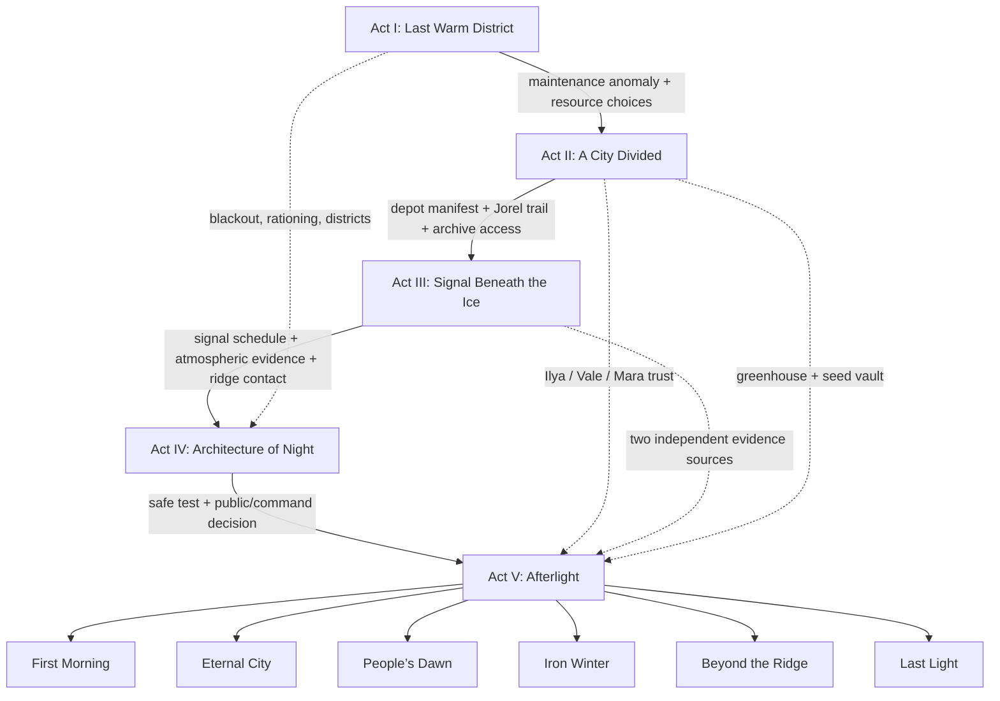

# AFTERLIGHT — Story Dependency Map

**Canon revision:** 2.1  
**Scope:** 123 nodes total: 83 implemented event records, six implemented ending outcomes, and 34 planned optional scenes, connected by 98 dependency edges.  
**Implementation status:** Acts I–V are playable through the final operation and six ending outcomes. Optional supporting scenes and expanded character-specific epilogues remain planned. The JSON map is the source of truth for event status.

## Dependency rules

- `requires`/trigger conditions gate availability; choice flags and evidence persist after the scene leaves the screen.
- Relationship values range from −100 to +100. Thresholds should gate optional approaches, not make the story impossible to finish.
- Evidence is a collected artefact; truth is a conclusion requiring corroboration.
- Chapter progress should be driven by act-climax state, not a random event rotation. Within a chapter, routine events can rotate, but unlocked consequence beats take priority.
- The player selects among gated final outcomes. Eligibility is determined by campaign conditions; notably, The First Morning requires the validated reset prerequisites.

## Campaign dependency overview

## Act 1 — The Last Warm District (1–14)

**Dramatic question:** Who pays when the city saves itself?  
**Act reveal:** A maintenance line and food shipments point to an unlisted relay facility.

| ID | Event | Status | Entry condition / dependency | Choice and forward consequence | Live City Feed |
|---|---|---|---|---|---|
| failing-grid | A dark sector | implemented | Campaign opening | Reroute, controlled blackout, or risky field repair. Sets western-grid response; introduces Mara/Vale or creates blackout fallout. | Default or blackout mood. |
| hospital-appeal | One more night of heat | implemented | Early survival crisis | Guarantee hospital power, rotate it, or deny the request. Changes population survival and the legitimacy of later emergency orders. | Hospital lights reflect the selected allocation in a future scene variant. |
| ration-ledger | The missing ledger | implemented | After first ration cycle | Publish the ledger, recover stock quietly, or punish the clerk. Introduces Ilya/Nadia and creates ledger/depot evidence or suppression. | Public-order and distribution visuals change. |
| heat-theft | The heat thieves | implemented | Early south-ring crisis | Legalise the shelter, relocate residents, or raid them. Builds Ilya/Vale standing and makes the southern ring stable, strained, or hostile. | Shelter lights and civic tension respond. |
| quiet-protest | The silent queue | implemented | Order pressure / ration queues | Hold an assembly, increase rations, or disperse the queue. Determines Ilya/Vale relationship movement and whether Act II opens cooperatively. | Unrest changes the plaza scene. |
| foundry-fire | Red metal | implemented | Parts shortage / foundry failure | Protect workers or divert residential ventilation. Creates a clean-industry or air-quality branch; affects array maintenance later. | Smoke mood only if residential ventilation is diverted. |
| night-garden | A garden in the dark | implemented | Food pressure / community opportunity | Fund the rooftop garden or return batteries to the clinic. Starts the greenhouse thread and affects Ilya’s trust. | Greenhouse mood if garden lights remain on. |
| greenhouse-mold | Something in the roots | implemented | Act I agriculture crisis | Burn infected beds, study the mould, or harvest early. Can preserve a hardy strain, lose the seed vault, or create a delayed food shortage. | Greenhouse condition changes only after the outcome. |
| radio-pirate | A voice on the band | implemented | Rumours intensify | Publish open data, jam the band, or invite the broadcaster to council. Sets public-information policy and whether later archive release is credible. | Radio lights/public-feed captions react. |
| power-broker | The copper compact | implemented | Day 3+; generator expansion opportunity | Accept the guild compact, negotiate a public contract, or reject it. Defines who controls repair contracts and how much leverage Vale/guilds gain. | Industrial work lights reflect investment. |
| mara-intake | The engineer’s intake | implemented | Immediately after failing-grid; required character introduction if not yet met | Let Mara brief the council in public or meet her alone. Public briefing gives Nadia/Ilya a record; private briefing earns Mara trust but conceals details. | Live feed overlays maintenance warning, not a new city mood. |
| west-temperature-map | A map of cold rooms | implemented | Any west-grid condition; blackout choices add unique dialogue | Publish room-by-room temperatures or keep a strategic map restricted. If published, Ilya gains evidence for hearings; if restricted, Vale gains operational advantage. | The western district map adds lit/dark windows. |
| council-evacuation-draft | Seats on the last tram | implemented | Energy ≤35 or blackout/ice-quake flags | Prepare voluntary evacuation lists or reject the premise of abandoning anyone. Establishes early evacuation policy; feeds Vale’s later contingency list. | Tram platforms appear occupied/empty in a later feed state. |
| ilya-clinic-visit | The clinic without stair lights | implemented | blackout-policy OR hospital-appeal deny OR heat-theft raid | Meet the families with Ilya or send Vale to handle it. Direct meeting warms Ilya; delegated security increases Vale’s influence but can deepen resentment. | Clinic windows and crowd presence change. |
| vale-night-patrol | A patrol with no orders | implemented | Public order below 55 or day ≥4 | Give Vale narrow written limits or broad emergency discretion. Creates constitutional-guardrail or expanded-security state. | Searchlights/checkpoints may appear in the city feed. |
| storehouse-manifest | The shipment that was not there | implemented | ration-ledger or copper-compact resolved | Trace the copper/food manifest or seal it as a clerical discrepancy. Connects the ration scandal to the unlisted relay; first route toward Jorel. | Storehouse bay lights and cargo movement update. |
| frost-witness | White cloth in the windows | implemented | blackout-extended OR order ≤40 | Interview residents publicly or classify the marks as sabotage. Builds Ilya trust/evidence or expands Vale’s coercive authority. | Distinct white cloth appears on dark-window silhouette layer. |
| quill-archive-request | A request for the old files | implemented | ledger-published OR open-broadcast OR day ≥5 | Grant Nadia a review team or demand a specific answer first. Introduces Nadia’s archival rules; respectful access opens First Night documents. | Archive status appears in city report, not the main skyline yet. |
| ration-audit | The second set of numbers | implemented | Any ledger outcome; strongest on publish/quiet-ledger | Conduct an independent audit or let the guild audit itself. Finds the diversion manifest, or records a compromised audit trail for later exposure. | Food-distribution status changes. |
| census-of-missing | Names omitted from the census | implemented | blackout/raid/punishment choices or ration audit | Restore missing residents to the official register or keep the count provisional. Connects population loss to Jorel’s disappearance and later public-truth choices. | Population-report UI changes; scene adds memorial lights. |
| maintenance-shift-log | The night the numbers changed | implemented | engineers, sun-calibrated, or storehouse evidence | Recover the original shift log or prioritise a repair using incomplete records. First documentary link between the Dawn Engine and DAWNLINE power routing. | Core control lights show unexplained activity. |
| night-watch-climax | A signal in the maintenance ledger | implemented | Day ≥7 and any two of ration/depot/maintenance evidence; otherwise a smaller clue appears | Trace the relay ID or file it for later. Act I ends on a concrete lead; no one yet knows the network’s purpose. | A line on the city map pulses toward Old Metro Line 9. |

## Act 2 — A City Divided (15–35)

**Dramatic question:** Who gets to know the truth, and who controls emergency power?  
**Act reveal:** Jorel’s death was never verified; records point toward a living settlement on the northern ridge.

| ID | Event | Status | Entry condition / dependency | Choice and forward consequence | Live City Feed |
|---|---|---|---|---|---|
| seed-vault | Seeds for a warmer world | implemented | Food/energy trade-off | Protect the seed vault or restore trams. Sets whether Vesper can sustain a recovery after the immediate crisis. | Seed-vault status changes later greenhouse lighting. |
| old-reactor | The sleeping reactor | implemented | Energy opportunity beyond perimeter | Attempt restart, strip for parts, or leave it sleeping. Creates a delayed power source, practical parts, or a missed opportunity. | Reactor beacon on the feed only if restart resolves successfully. |
| outside-voice | Someone at the gate | implemented | Northern traveller reaches Vesper | Admit, treat/question, or refuse the traveller. Creates an early northern-route clue and a moral record used by Ilya/Nadia. | North-gate warmth and traveller silhouette change. |
| ice-quake | The ground moves | implemented | Infrastructure event | Evacuate a tunnel, reinforce the coolant main, or wait. Controls whether the underground expedition is safe and whether reactor repair parts survive. | Ground fissures/steam alter industrial skyline. |
| blackout-aftermath | The dark has a street address | implemented | blackout-policy and lights not restored | Restore clinic/stairwell lighting or extend the blackout. Improves west-district condition or darkens additional districts; updates Ilya/Vale. | Blackout scene persists or begins recovery. |
| plaza-after-sirens | Lanterns without flames | implemented | Raid, hall cleared, clerk punished, or curfew choice | Hold an assembly or impose a curfew. Civic compact vs hardened opposition branch. | Crowd/curfew lighting changes. |
| greenhouse-network | A green light spreads | implemented | garden-funded, mold-study, or seed-vault-saved | Link the grow-lamp network or return lamps to heating. Creates self-sustaining food route or defers it for immediate heat. | Greenhouse stays active or dims. |
| northern-visitor-interview | The traveller knows the name | implemented | traveller-questioned OR traveller-admitted plus route-map clue | Trust the traveller’s account or verify it against Nadia’s archive. Links outside-voice to the ridge settlement without revealing DAWNLINE too early. | North-gate feed adds a map marker. |
| quill-vault-access | The shelf without a label | implemented | Nadia met and respectful archive access OR independent audit | Give Nadia a small team or insist on a witness from the public council. Opens a partial First Night transcript; oversight increases public confidence. | Archive page appears in evidence dossier. |
| vale-contingency-list | The city that will be left behind | implemented | vale-night-patrol with expanded discretion OR population pressure | Publish Vale’s evacuation list or let him keep it as an operational fallback. A published list costs Vale trust but prevents secret use; secrecy strengthens his later coup path. | Map shows districts pre-marked for evacuation. |
| mara-black-box | The black box has two clocks | implemented | maintenance-shift-log evidence | Preserve the power log and lose repair time or overwrite it to stop a cascade. Preservation adds DAWNLINE clue; overwrite keeps energy but costs future proof. | Dawn Engine display gains a timestamp anomaly. |
| jorel-trail | A name on a cargo tag | implemented | storehouse-manifest OR census-of-missing evidence | Trace Jorel’s tag north or follow the copper shipment first. Creates one of two paths to Jorel’s survival record. | Northbound cargo trace added to city feed map. |
| clinic-blackout-case | Three patients, one missing hour | planned | blackout-impact-log OR hospital deny/rotate choices | Make the report public or use it to redesign emergency power priorities. Public release builds accountability; private redesign builds practical resilience. | Clinic becomes recovering only after allocation changes. |
| white-cloth-windows | The neighbourhood marks its own map | planned | blackout-extended or census-of-missing | Negotiate a district repair rota or send security to remove markers. Civic repair network vs escalation; gives different allies in Act IV. | Window lights return district by district only after repairs. |
| copper-guild-dispute | Who owns the spare parts? | planned | copper-compact OR public-contract | Accept guild control, renegotiate ownership, or seize the stock. Determines access to the gantry workshop and who can sabotage/withhold parts. | Foundry and repair-yard visuals update. |
| repair-or-sacrifice | The coolant main splits | planned | ice-quake plus old-reactor or energy ≤30 | Save hospital coolant or reactor containment. Branches later power capacity and public-health losses; neither choice is free. | North causeway damage state changes. |
| public-hearing | A hearing with the doors open | implemented | ledger published OR audit complete OR public assembly held | Allow sworn testimony or restrict the hearing to technical officials. Ilya/Nadia trust and public knowledge become durable campaign state. | Crowd gathers in a civic space. |
| hidden-depot-access | The door beneath the storehouse | implemented | ration-diversion-ledger OR depot manifest + Nadia access | Enter with a public warrant or send a covert team. Public entry builds legitimacy; covert entry may get Jorel’s record sooner but risks Vale’s discovery. | A sealed industrial hatch becomes visible. |
| ledger-second-copy | The copy that left the city | implemented | hidden depot accessed or traveller route verified | Recover a courier copy or protect the courier from prosecution. Provides the second independent proof needed for the Northworks/relay link. | Courier route appears on the city map. |
| conservatory-seed-test | Something grows without the lamps | planned | hardy strain sample OR seed vault saved | Run a controlled trial or distribute seed stock early. Controlled trial is safer; early distribution improves food but risks contamination. | Tiny greenhouse lights grow or are quarantined. |
| winter-vote | Emergency rule, one more month | implemented | public-hearing + Vale standing; fallback on order ≤30 | Renew emergency powers with oversight or set an end date and civilian review. Sets a major legitimacy flag used by Iron Winter/People’s Dawn outcomes. | Civic hall light status reflects vote. |
| security-confrontation | Orders from two offices | planned | vale-contingency-list kept secret OR security expanded | Back Vale’s unilateral command or require joint civilian/technical authorisation. Sets the security chain-of-command for the Act IV siege. | Checkpoint deployment changes. |

## Act 3 — The Signal Beneath the Ice (36–60)

**Dramatic question:** What does the darkness protect, and what does it conceal?  
**Act reveal:** DAWNLINE is still cycling under autonomous rules; a settlement beyond the ridge has survived.

| ID | Event | Status | Entry condition / dependency | Choice and forward consequence | Live City Feed |
|---|---|---|---|---|---|
| signal-below | A signal below | implemented | Line 9 transmitter found; unlocked after investigation opportunity | Send a science team or seal the tunnel. Introduces Elias, evidence fragments and the investigation route. | Signal anomaly mood. |
| signal-echo | The forecast from thirteen years ago | implemented | signal-investigated and not cut/decoded | Decode the archive, broadcast coordinates, or cut the transmitter. Evidence can become a shared schedule or a lost lead; alters Elias/Ilya standing. | Aurora/atmospheric anomaly mood. |
| glass-sky | The glass sky | implemented | Technology threshold; observatory anomaly | Power a full scan or archive early readings. Creates explicit atmospheric-window evidence required for the late pulse. | Sky scan gains a visible contour. |
| last-transmission | A message from the ridge | implemented | signal-investigated and day ≥6 | Coordinate the experiment or protect power at home. Creates ridge alliance or isolation; alliance gives later reset options. | A distant relay light answers. |
| rook-confession | The fragment he did not report | planned | Elias met and line-9 evidence discovered | Let Elias publish his withheld fragment or require a controlled verification. Trust opens quicker decoding; distrust adds a verification event but does not remove the clue. | Signal waveform reveals a missing segment. |
| signal-phase | Nine hours, not nine words | planned | line-9-transmitter-pulse or dawnline-schedule | Sync the transmitter against local array logs or a radio telescope. Confirms period and timing; both routes produce evidence with different resource costs. | Aurora pulses on a nine-hour cycle. |
| ridge-map | Coordinates under the frost | implemented | northern-route-map OR signal schedule decoded | Use traveller map or derive a route from the signal. Determines expedition hazards and whether the team trusts the northern beacon. | Ridge line and route appear in the Live City Feed. |
| expedition-prep | What can travel without heat? | implemented | ridge-map plus energy/food budget | Send engineers, archivist, or a mixed team. Team composition changes which clues are found and who survives a hazard. | Convoy lights appear at city perimeter. |
| ridge-crossing | The whiteout crossing | implemented | expedition launched | Follow the safe beacon route or cut across the exposed pass. Safe route costs time; short route risks supplies or a key specialist. | Storm and distant beacon visual. |
| weather-station | A station still recording | implemented | ridge crossing succeeds | Recover the station drives or power the live array first. Creates raw atmosphere data and reveals the network’s repeating protective cycle. | A remote tower wakes in the feed. |
| jorel-evacuation-record | The name marked transferred | implemented | Jorel cargo trail + station or depot records | Verify the evacuation record before telling Ilya or tell her immediately. Proof of survival is separate from reunion; secrecy changes Ilya’s trust. | A personal record appears in the dossier. |
| ridge-settlement | A city that learned to wait | implemented | expedition or live transmission succeeds | Negotiate openly, trade supplies, or gather intelligence covertly. Determines whether the northern settlement will coordinate a reset. | Second settlement lights appear beyond the ridge. |
| remote-mirror | The mirror field | implemented | ridge settlement contact + prototype/atmosphere data | Borrow the mirror array or protect the settlement’s own survival system. Creates a technical component for reset; coercion closes future alliance routes. | Remote mirror beams flicker in the skyline. |
| relay-repair | The relay has a human lock | planned | ridge-map + evidence of repeated signal | Repair the relay with shared parts or bypass its safety lock. Shared repair improves alliance; bypass gives speed but causes a later unstable pulse. | Signal becomes stable or visibly noisy. |
| dawnline-archive-fragment | A protocol signed by nobody | implemented | weather-station OR Quill archive evidence plus signal schedule | Decode the autonomous header or pursue the human authorisation trail first. First clear proof the system is autonomous; author trail points toward Mara’s override. | Old DAWNLINE protocol appears in evidence. |
| station-interrogation | The last operator’s recording | planned | archive fragment + northern station recovered | Release recording, preserve it for court, or keep it under technical custody. Changes public knowledge and Nadia/ Vale relationship; all paths retain the actual truth. | Recorder waveform; public feed changes only if released. |
| first-night-transcript | The minutes before the sky closed | planned | Quill vault + station/relay evidence | Read all transcript or publish an annotated extract. Establishes the solar catastrophe was real while the continued veil was a later system failure. | Dawn Engine status panel gets original activation timestamp. |
| proof-of-veil | The veil has a schedule | implemented | weather data + signal phase + atmospheric scan (any 2 independent sources) | Request a peer review or act on provisional evidence. Peer review costs time but broadens trust; rapid action makes the next test riskier. | Atmospheric waves become more legible. |
| signal-public-release | The city hears the pulse | planned | public-broadcast-copy OR hearing and two independent signal clues | Broadcast the full data or release a verified summary. Sets public knowledge, avoiding the simplistic “truth always helps” outcome: timing and verification matter. | Public displays repeat the signal pattern. |
| ridge-envoy | A representative at the wall | implemented | ridge settlement contact + public or verified signal release | Welcome an envoy publicly or negotiate through Elias/Nadia. Public route builds civic legitimacy; private route may be faster but less accountable. | A second flag/light appears on the skyline. |
| cross-settlement-compact | One protocol, two cities | implemented | ridge alliance + confirmed atmospheric window + any two technical evidence items | Sign a reciprocal reset compact or keep the process under Vesper command. Shared protocol enables best ending; Vesper-only control increases risk and makes outcomes depend more heavily on reserves. | Twin signal beams sync across ridge. |
| third-signal-clue | The voice after the schedule | implemented | line-9 signal intact and signal phase confirmed | Answer with a proof-of-life code or listen silently for another cycle. The reply is Jorel’s maintenance code, proving he reached the relay crew without instantly explaining DAWNLINE. | Signal waveform gains a human-coded pattern. |

## Act 4 — The Architecture of Night (61–90)

**Dramatic question:** Can the truth be made public without destroying the fragile system that keeps people alive?  
**Act reveal:** The veil is maintained by autonomous safety routines; a safe handoff needs several cities and human safeguards.

| ID | Event | Status | Entry condition / dependency | Choice and forward consequence | Live City Feed |
|---|---|---|---|---|---|
| sun-engine | The sun engine | implemented | Technology threshold; array safety debate | Overdrive for immediate warmth or calibrate a safer cycle. Sets mirror fracture or safe-cycle evidence and Mara relationship. | Fractured/dawn engine mood. |
| mirror-proposal | The mirror proposal | implemented | Technology threshold | Fund the prototype or shelve it. Provides remote-light technology or preserves reserves. | Prototype lights/extra glints in sky. |
| mirror-fractures | A sun with a broken edge | implemented | sun-overdriven and mirror bank unresolved | Repair the mirror crew’s bank or isolate it. Repairs core or preserves safety with reduced output. | Fractured mood clears only after repair/isolation resolution. |
| dawnline-access | The facility behind the false wall | implemented | Quill archive + depot/relay evidence and technology threshold | Enter under public warrant or use Vale’s emergency authority. Public warrant builds legitimacy; Vale entry boosts access but gives security leverage. | Hidden facility access light opens. |
| mara-override-confession | The override with her name on it | implemented | Dawnline access + Northworks record | Let Mara testify, negotiate protected testimony, or discredit the record. Mara can become accountable partner or withdraw; evidence remains in world state. | Engineering scene adds archived incident markers. |
| vale-abandonment-order | The list was already written | planned | Vale contingency list discovered or security command unchecked | Publish the list and constrain Vale or accept his plan as triage doctrine. Sets People’s Dawn / Iron Winter prerequisites and who controls Act V evacuation. | District evacuation markers appear. |
| jorel-reunion | A voice from the far station | implemented | Jorel survival confirmed + ridge alliance + Ilya trust ≥12 | Arrange a protected reunion or send a message first. Reunion yields his manifest testimony; distance preserves safety but may strain Ilya. | Live feed radio console shows a personal channel. |
| quill-full-archive | The pages she kept | implemented | Nadia met + First Night transcript evidence | Release full archive, annotate it with independent review, or retain sensitive pages. Full release raises transparency and immediate unrest risk; review creates a slower shared record. | Archive wall/municipal displays change. |
| gantry-workshop | A repair crew from both cities | implemented | copper public contract OR ridge alliance | Build the gantry with guilds or the mixed public crew. Guild build is faster but creates contract leverage; public crew needs Ilya/engineering trust. | Gantry scaffold appears around the artificial sun. |
| mirror-calibration | Point the mirrors at the gap | implemented | prototype mirror data + sky window + safe cycle | Use model-derived calibration or copy the ridge’s empirical method. Both can work; only the first preserves a redundant safety margin without additional evidence. | Narrow beam aligns with a gap in the sky. |
| orbital-telemetry | The network answers back | implemented | dawnline archive fragment + mirror calibration | Read the handshake or isolate the uplink during the next window. Confirms autonomous lockout and identifies a human verification challenge. | Orbital lights pulse in a matching pattern. |
| veil-model | The safety model that never ended | implemented | first-night transcript + orbital telemetry + signal schedule | Accept peer review or rely on the technical council alone. Adds veil-is-maintained and Dawnline-autonomous truths if prerequisites met. | Sky pattern reveals a timed corridor. |
| grid-rebuild | A grid that can survive a reset | implemented | reactor online OR greenhouse/network and enough technology | Rebuild redundant loops or conserve for the immediate pulse. Redundancy lowers pulse risk and helps Eternal City if the pulse is deferred. | District lights connect as a visible network. |
| seed-network-expansion | Food after the first light | planned | greenhouse network live or seed vault saved | Expand seed network now or reserve energy for the pulse. Food resilience supports evacuation/recovery; saving energy improves immediate array headroom. | Greenhouse nodes spread across city silhouettes. |
| public-trial | A trial without a scapegoat | planned | Mara override evidence + public hearing or full archive | Hold a transparent hearing or handle the incident privately. Public accountability builds civic trust; private deal may preserve immediate order but empowers Vale. | Civic plaza scene changes based on audience/control. |
| security-oath | Who guards the switch? | planned | Vale relationship or emergency authority decision | Have Vale swear to civilian oversight or appoint a technical/civic joint guard. Vale can become a constitutionally bound ally, remain neutral, or resist. | Searchlights shift away from residential blocks if oversight holds. |
| northern-crew-recruited | The ridge crew crosses the wall | planned | ridge compact plus a stable route | Welcome skilled operators into Vesper or keep the team at the relay. Local crew adds resilience; remote coordination is safer politically but less robust technically. | New repair lights appear near array. |
| dawnline-ethics-vote | A system needs a human answer | planned | veil model confirmed + public knowledge/oversight state | Accept human-in-the-loop reset protocol or preserve autonomous safeguards. Defines final control architecture and ending availability. | Control chamber shows either human key or locked indicator. |
| first-test-pulse | A seam in the clouds | implemented | calibration, relay repair, and sufficient energy | Run a tiny test now or wait for redundancy. Success yields light-corridor evidence; premature testing damages core and trust. | Brief light slit only on actual test success. |
| test-pulse-failure | The light came back wrong | implemented | first test initiated without safety margin OR bad alignment | Abort and repair or conceal the failure to keep morale. Abort preserves lives but costs energy; concealment adds future public-trust penalty. | Sky returns to dark; a damaged mirror indicator persists. |
| test-pulse-success | Five seconds of morning | implemented | first test with safety margin / ridge coordination | Measure the corridor or broadcast the success first. Measurement generates dependable timing evidence; broadcast first boosts morale but crowds control window. | A genuine short-lived daylight state appears, then naturally fades. |
| core-facility-siege | The gates below the engine | planned | Vale conflict + public-revelation conflict or technical emergency | Defend the core with civic guards, negotiate, or give security full authority. Can consume characters, damage control hardware, or produce a joint command if trust is high. | Core facility lockdown in feed. |
| act4-final-vote | The reset is not a switch | implemented | veil maintained truth + enough tech + test result resolved | Vote for coordinated reset, local-only preservation, or staged evacuation. Locks Act V strategy but preserves individual last-minute decisions. | The city feed shifts to whichever operation is actually prepared. |

## Act 5 — Afterlight (Final crisis)

**Dramatic question:** Will the future belong to the people who survive it?  
**Act reveal:** The player’s accumulated policy, relationships, knowledge, and preparation determine both the operation and the society after it.

**Current implementation boundary:** Act V is playable through `act-five-briefing`, `act-five-commitments`, `act-five-jorel-dispatch`, and `act-five-final-operation`. The final operation resolves to one of six outcomes. Supporting scene ideas in the blueprint remain optional/planned nodes rather than separately playable events.

| ID | Event | Status | Entry condition / dependency | Choice and forward consequence | Live City Feed |
|---|---|---|---|---|---|
| dawn-equation | The dawn equation | implemented record (legacy, not routed) | Retained in the source for compatibility; not part of the Act V sequence | The active final path uses `act-five-briefing` → `act-five-commitments` → `act-five-jorel-dispatch` → `act-five-final-operation`. This older event is not selected by the chapter router. | No effect on the active final sequence; kept out of the current chapter route. |
| final-evacuation | The lower ring is flooding with cold | planned optional scene | Act IV final vote and core condition | Evacuate vulnerable districts in order or keep workers in place for the reset. Affected districts and population determine the human cost of every ending. | Evacuation lights/convoys alter feed. |
| last-power-allocation | One reserve, three needs | planned | final evacuation and grid-rebuild state | Allocate power to hospitals, mirror control, or the northern relay. The selected subsystem receives a safety margin; the others develop a corresponding risk. | Energy channels visibly illuminate one subsystem. |
| public-truth-broadcast | The record goes live | planned | public-trial/full archive/public knowledge state | Broadcast verified evidence now or let the operation speak first. Public disclosure changes cooperation and unrest; withheld evidence enables authoritarian control but damages post-reset legitimacy. | Civic displays/people in plaza update. |
| mara-on-the-gantry | The last calibration | planned | Mara trusted or engineering record preserved | Give Mara direct authority, use a second engineer, or deny her access. Trusted Mara lowers technical risk; excluding her costs time; coercion may prompt refusal. | Gantry close-up state reflects crew availability. |
| ilya-switchyard | The people at the switchyard | planned | Ilya relationship and public legitimacy states | Invite civilian observers, negotiate with the crowd, or clear the switchyard. Strong Ilya trust creates a safe civilian corridor; repression may trigger strike/siege. | Crowd clears, coordinates, or surges. |
| vale-final-command | The order that will be remembered | planned | security-oath and Vale standing | Order Vale to hold the line, transfer command, or accept his emergency plan. Defines whether security protects the operation, withdraws, or attempts a takeover. | Searchlight/security layer updates. |
| rook-frequency-lock | Hold the signal open | planned | Elias trust plus repaired relay | Let Elias keep the channel open or cut interference manually. Good standing preserves timing; poor standing creates a manual-risk option. | Aurora pulse aligns or breaks. |
| quill-records-release | Who will remember this honestly? | planned | Nadia trust and archive disposition | Release the entire verified record or preserve sealed evidence for a later tribunal. Determines public history, character survival/loyalty epilogues, and legitimacy ending gate. | Public archive feed changes. |
| ridge-pulse-window | The ridge gives its answer | planned | ridge alliance + timing evidence | Synchronise two-city pulse or attempt Vesper-only alignment. Coordinated pulse lowers risk; solo pulse possible only if technical safeguards compensate. | Twin artificial-sun beams align across scene. |
| dawnline-core-entry | Into the machine’s memory | planned | DAWNLINE access + telemetry + proper command authorization | Enter with human key and evidence or bypass the lockout. Human key creates accountable reset; bypass risks permanent lockout/last-light route. | Core chamber and network UI change. |
| core-safety-debate | Keep the shield, open the gap | planned | DAWNLINE core entered | Preserve emergency shield in staged mode or open a narrow controlled corridor. A full shutdown is never offered as a safe default; the meaningful choice is the transition protocol. | Sky begins warming only in staged/corridor sequence. |
| network-handshake | Two cities, one timing window | planned | ridge-pulse-window plus core safety protocol | Accept northern authority on timing or centralise command in Vesper. Joint governance creates the safest reset; unilateral command is faster but raises failure risk. | Twin relay signals synchronise. |
| final-control-vote | Who owns the morning? | planned | network handshake and security outcome | Choose civic compact, technical trusteeship, emergency command, or evacuation leadership. Selects political structure of epilogues, not whether the engineering outcome automatically succeeds. | City civic/security state becomes permanent. |
| pulse-outcome | The last pulse | planned | Power allocation, relay lock, calibration, grid and command states | Execute staged pulse, abort into permanent artificial light, or evacuate before a failed core. Engine calculates success/risk from prior state. No outcome is random without warning; risks are telegraphed. | Dawn only if success conditions resolve. |
| end-state-review | The cost of the future | planned | Any ending condition | No new life-or-death choice; present the campaign ledger. Summarises districts saved/lost, key relationships, evidence published, and the decisions that made the ending possible. | Final Live City Feed freeze-frame. |
| ending-first-morning | ENDING — The First Morning | implemented ending | Staged pulse succeeds; sufficient technology, power, evidence, coordination, and live grid | Natural light returns through a stable corridor; DAWNLINE moves to supervised recovery. Best scientific outcome; epilogue changes with public legitimacy and character testimony. | Golden natural dawn; skyline stays transformed. |
| ending-eternal-city | ENDING — The Eternal City | implemented ending | Reset deliberately deferred/aborted; stable engine + viable food + no catastrophic collapse | Vesper survives using improved artificial light and a repaired civic/infrastructure system. A defensible, bittersweet survival ending; not a “bad” ending if chosen knowingly. | Stable warm artificial sun, no natural sunrise. |
| ending-peoples-dawn | ENDING — The People’s Dawn | implemented ending | Recovery/reset succeeds with high civic legitimacy, accountable command, and public evidence | The transition belongs to a civic compact rather than one leader or machine. Best political outcome; scientific outcome may be partial but public ownership is durable. | Sunrise plus busy, lit public square. |
| ending-iron-winter | ENDING — The Iron Winter | implemented ending | Vesper survives, but Vale/emergency command dominates and truth stays restricted | The city remains alive and orderly under permanent emergency authority. Control ending with high survival but low freedom; character epilogues reflect coercion. | Searchlights and controlled districts beneath artificial dawn. |
| ending-beyond-ridge | ENDING — Beyond the Ridge | implemented ending | Reset not viable, but route, supplies, settlement agreement, and evacuation plan are secured | Vesper evacuates a viable population toward the northern settlement. Hopeful migration ending; the fate of the old city and those left behind is stated honestly. | Convoy lights cross the frozen ridge. |
| ending-last-light | ENDING — The Last Light | implemented ending | Survival threshold breached or the final operation fails without an alternative plan | The engine fails and the city cannot sustain a transition. Tragic ending summarises which earlier choices narrowed the options; not an arbitrary random death. | City scene loses light according to the systems that failed. |

## High-value dependency edges (implementation contract)

| From | To | Gate / reason |
|---|---|---|
| `failing-grid` | `blackout-aftermath` | implemented |
| `failing-grid` | `mara-intake` | implemented |
| `ration-ledger` | `storehouse-manifest` | implemented |
| `ration-ledger` | `public-hearing` | implemented |
| `heat-theft` | `ilya-clinic-visit` | implemented |
| `blackout-aftermath` | `clinic-blackout-case` | implemented |
| `blackout-aftermath` | `frost-witness` | implemented |
| `power-broker` | `copper-guild-dispute` | implemented |
| `storehouse-manifest` | `ration-audit` | implemented |
| `storehouse-manifest` | `jorel-trail` | implemented |
| `maintenance-shift-log` | `mara-black-box` | implemented |
| `ration-audit` + `maintenance-shift-log` | `night-watch-climax` | Two independent anomalies; single-clue fallback still exists. |
| `night-watch-climax` | `signal-below` | implemented |
| `signal-below` | `signal-echo` | implemented |
| `signal-below` | `rook-confession` | implemented |
| `outside-voice` | `northern-visitor-interview` | implemented |
| `northern-visitor-interview` | `ridge-map` | implemented |
| `ridge-map` | `expedition-prep` | implemented |
| `expedition-prep` | `ridge-crossing` | implemented |
| `ridge-crossing` | `weather-station` | implemented |
| `jorel-trail` + `weather-station` | `jorel-evacuation-record` | Two records independently verify the transfer. |
| `jorel-evacuation-record` + `ridge alliance` + Ilya ≥ +12 | `jorel-reunion` | A reunion needs proof, a viable route, and relationship trust. |
| `signal-echo` + `glass-sky` | `proof-of-veil` | Signal period and atmospheric window form independent clues. |
| `proof-of-veil` + `weather-station` | `dawnline-archive-fragment` | The old safety protocol can be reconstructed. |
| `dawnline-archive-fragment` + `orbital-telemetry` | `veil-model` | Establishes the autonomous lockout. |
| `ration evidence` + `Quill archive` + `relay fragment` | `dawnline-access` | Makes the hidden facility discovery evidence-based, not random. |
| `dawnline-access` + Northworks record | `mara-override-confession` | Mara’s local action becomes relevant to global truth. |
| `vale-contingency-list` + `security-confrontation` | `security-oath` | Determines chain of command in the final operation. |
| `prototype-mirror-data` + `atmospheric-window-anomaly` + `safe-cycle-calculation` | `mirror-calibration` | Three independent technical supports; alternate empirical route has higher risk. |
| `mirror-calibration` + `relay-repair` | `first-test-pulse` | Only run a test when timing and alignment are prepared. |
| `first-test-pulse` | `test-pulse-success` OR `test-pulse-failure` | implemented |
| `veil-model` + resolved test + adequate grid | `act4-final-vote` | The crisis becomes political as well as technical. |
| `act4-final-vote` | `final-evacuation` | implemented |
| `final-evacuation` + `grid-rebuild` | `last-power-allocation` | The player chooses which system receives reserve power. |
| `last-power-allocation` + `relay-repair` + `mirror-calibration` | `ridge-pulse-window` | A coordinated window is available if the ridge compact exists. |
| `dawnline-access` + authorization state | `dawnline-core-entry` | Human-key access or risky bypass. |
| `dawnline-core-entry` + `veil-model` | `core-safety-debate` | Full shutdown is not treated as safe; the choice is transition protocol. |
| `core-safety-debate` + `ridge-pulse-window` | `network-handshake` | Allows shared timing or a higher-risk Vesper-only attempt. |
| `network-handshake` + `security-oath`/security outcome | `final-control-vote` | Political legitimacy is separate from scientific success. |
| `final-control-vote` + power/grid/relationship state | `pulse-outcome` | Resolves successful dawn, stable artificial light, evacuation, or collapse. |
| `pulse-outcome` | exactly one ending node | planned |

## Required shared state

| State | Purpose | Examples |
|---|---|---|
| Character standing | Determines trust, testimony, help, and opposition. | `mara`, `ilya`, `vale`, `elias`, `nadia` from −100 to +100. |
| Evidence | Preserves objective artefacts and testimonies. | `ration-diversion-ledger`, `line-9-transmitter-pulse`, `atmospheric-window-anomaly`. |
| Confirmed truths | Stores conclusions supported by multiple items. | `signal-is-schedule`, `veil-is-maintained`, `dawnline-is-autonomous`. |
| District condition | Makes changes visible and persistent. | `west: dark → recovering`, `south: strained → sealed`. |
| Chapter and act gates | Prevents late-act scenes from appearing before the necessary setup. | `chapter: 1..5`; climax conditions. |
| Existing flags | Continue to control specific event resolutions and scene details. | `blackout-policy`, `array-repaired`, `ridge-alliance`, `dawn-reached`. |

## Evidence-to-truth requirements

| Truth | Minimum evidence / prerequisite set | First safe reveal |
|---|---|---|
| `signal-is-schedule` | `line-9-transmitter-pulse` + `dawnline-schedule` | Act III: Signal Echo |
| `ridge-settlement-survived` | `northern-route-map` + live response from ridge relay | Act III: Ridge Settlement |
| `veil-is-maintained` | `atmospheric-window-anomaly` + `dawnline-schedule` or station telemetry | Act III–IV: Proof of Veil |
| `dawnline-is-autonomous` | DAWNLINE archive fragment + orbital telemetry | Act IV: Veil Model |
| `first-night-was-an-emergency-response` | First Night transcript + independent review of the old power log | Act IV: Quill Full Archive |
| `safe-reset-requires-coordination` | Successful calibrated test + ridge compact + DAWNLINE handshake | Act IV: Ethics Vote / Act V |

## Branch reconvergence points

1. **Act I → Act II:** blackout, hospital allocation, and grid repair reach the same winter emergency, but change district condition, characters present, and which evidence is available.
2. **Act II → Act III:** public audit, covert depot entry, and traveller route converge on the northern clue; the player may arrive with public legitimacy, a covert advantage, or an incomplete map.
3. **Act III → Act IV:** direct expedition, signal-only research, and archive-first research all lead toward the veil model, but alter evidence quality, alliance strength, and timing risk.
4. **Act IV → Act V:** safe test, failed test, and delayed test all reach the final crisis. A failure must change the cost and available fallback, not simply restart the same scene.
5. **Act V endings:** political outcomes and scientific outcomes are evaluated separately. A successful sunrise under authoritarian control is distinct from a sunrise under civic governance.

## Event acceptance checklist

- Every event has at least one prerequisite or an explicit chapter-entry role.
- Every major choice writes one or more persistent consequences: flags, standing, evidence, district state, resources, or a delayed effect.
- Every evidence item has at least one later use; every confirmed truth has at least two independent supports.
- No major revelation depends only on a single random event. Provide a fallback path if the player misses its first clue.
- The current event selector must stop using an unbounded random/rotating pool as chapter structure; climax and consequence events receive deterministic priority.
- A critical character being hostile changes route/cost/scene but should not silently delete the only viable main-story path.
- City imagery changes only when corresponding persistent state changes, then remains consistent until repaired or resolved.
- Final reports list the pivotal choices and consequences that earned the ending.
